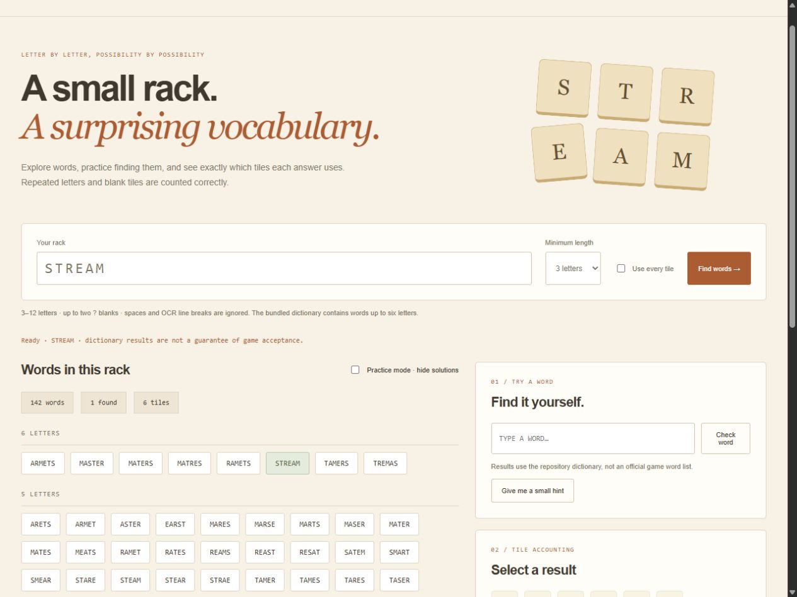

# Game-Pigeon-Anagrams · Anagram Atelier

A portable rack explorer and word-practice tool, built from the original iPhone Mirroring helper. Search runs locally against the existing 43,117-entry repository wordlist. The browser needs no Python packages, phone connection or mouse automation.



## Browser and CLI

```bash
python -m http.server 49219
# Open http://localhost:49219/web/

python Anagrams/main.py STREAM
python Anagrams/main.py "TE?AMS" --json
python Anagrams/main.py LETTER --exact
```

Python 3.10+ is sufficient for the CLI. Racks accept 3–12 A–Z letters with up to two `?` blanks; whitespace from manual OCR input is ignored. The bundled dictionary contains words only up to six letters, so longer racks still return only those shorter words. Minimum-length and full-rack filters are available in the browser.

Practice mode hides solutions until you find them. Duplicate guesses do not count twice, hints reveal only a word's length and first letter, and found words save locally per rack. Select any result to inspect its exact tile order, including three or more repeated letters and blanks. Export includes all current results and their source limitation.

## Correctness improvements

- The browser traverses a trie in a worker; the Python solver checks dictionary letter counts. Neither generates factorial permutations. Results are unique, longest-first and alphabetical within a length.
- Tile mapping uses original indices and never consumes the caller's coordinate list. The old doubled-letter key could not distinguish a third copy of a letter.
- Dictionary paths resolve relative to the module, so the CLI works from another working directory.
- Desktop libraries are imported only when mouse guidance is explicitly requested. The default CLI is cross-platform and does not move the pointer.
- Invalid racks, impossible tile mappings, unavailable dictionaries and duplicate guesses have explicit feedback.

## Tests

```bash
npm test
python -m unittest discover -s tests -p "test_*.py"
```

Ten Node tests compare trie search to an independent count oracle and to Python on the actual dictionary, and cover repeated tiles, blanks, ordering and practice validation. Seven Python tests cover exact-helper compatibility, normalization, tile plans, working-directory independence and inert imports. Browser checks cover practice persistence, duplicate guesses, `AAABBC → ABACA`, blank use, invalid-input blocking and mobile layout.

## Optional macOS mouse guidance

The original iPhone Mirroring idea remains as a separately opted-in helper:

```bash
python -m pip install -r requirements-macos.txt
python Anagrams/main.py STREAM --guide-mouse
```

It requires macOS, iPhone Mirroring, the relevant accessibility permissions and the original six-tile layout. Omitting letters in this mode attempts OCR, requiring a separately installed Tesseract executable and explicit confirmation of the detected rack. You still click each tile yourself. Escape stops before the next movement; the PyAutoGUI corner fail-safe remains enabled. The helper's pure tile plans are tested, but macOS OCR, geometry and physical mouse behavior were not run on the Windows development machine. Do not assume another phone/window layout is compatible.

## Dictionary and project provenance

`Anagrams/wordlist.txt` is unchanged from this repository's original public version. Its upstream provenance and official game acceptance are unverified; it includes obscure words and inflections. No claim is made that every result is accepted by GamePigeon, and no new dictionary license is asserted. This project is unaffiliated with GamePigeon. The original tutorial is preserved below as historical context; its old installation and automatic-start instructions are superseded by the commands above.

## Original tutorial reference

[Original video tutorial](https://youtu.be/UP74BFGNz6Q)

<details><summary>Historical README (superseded)</summary>

## Video Tutorial 
<pre>https://youtu.be/UP74BFGNz6Q</pre>

## Prerequisites
1. MacOS running MacOS 15 or higher
2. iPhone with GamePidgeon
3. Python 3

## How to install?

1. Git-clone this repo & change directory

   <pre>git clone https://github.com/Ashwin-Iyer1/Game-Pidgeon-Anagrams.git</pre>
   <pre>cd Game-Pidgeon-Anagrams</pre>
2. Install modules using pip:
   <pre>pip install -r requirements.txt</pre>
3. Make sure you have iPhone Mirroring launched and on the Anagrams start screen
4. Press start
5. Run the .py file!
   <pre>python main.py</pre>
6. Quickly go to the iPhone Mirroring application and wait for the OCR to run
5. If the console tells you that the OCR did not work, enter letters manually in 1 word (ABCDEF)
6. Let the program move the mouse while you just keep clicking
7. When stopping the program, it may perform the last few clicks / movements!!!!!!! (I do not know why)
   
   **This program is written quite poorly with little error handling so if you have any issues please refer to the video below

</details>
